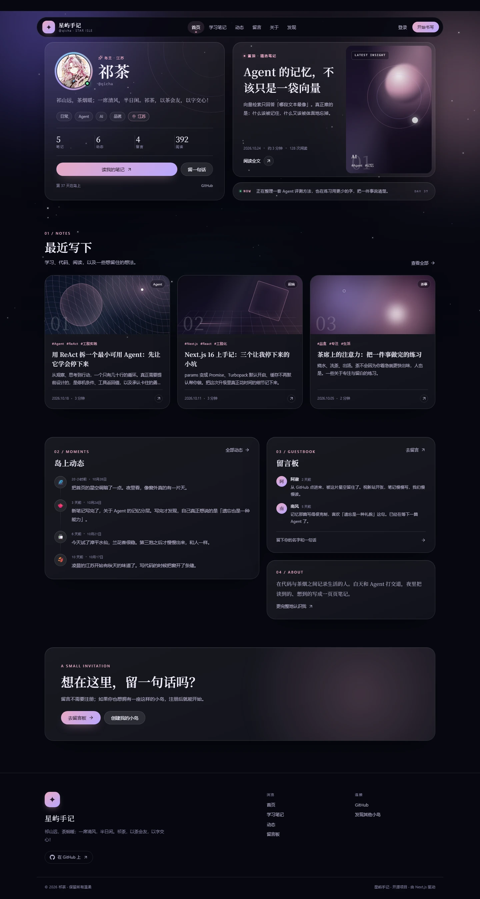
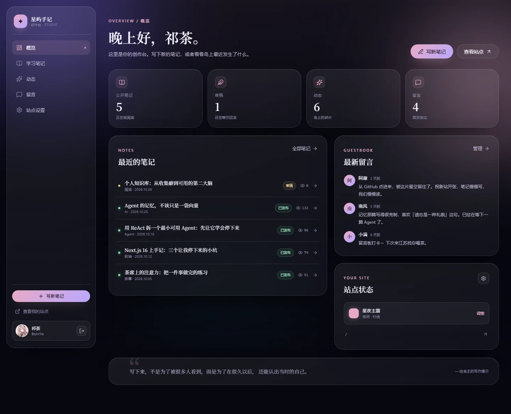
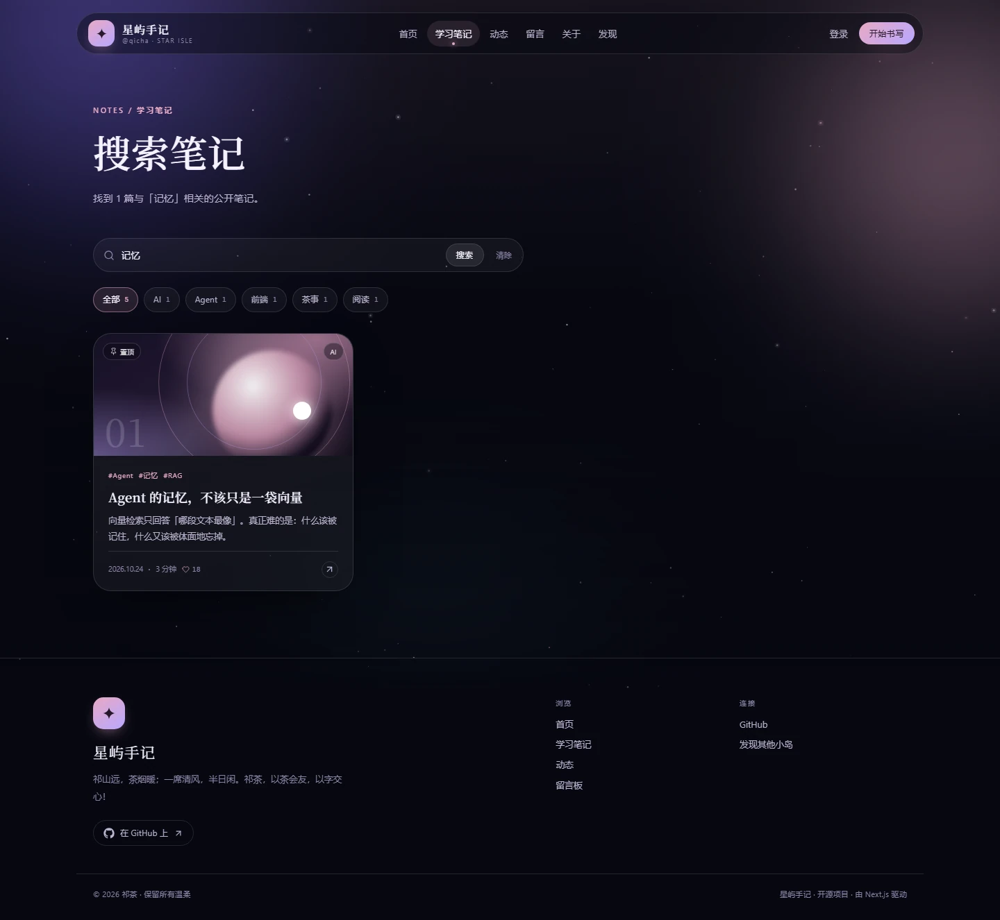
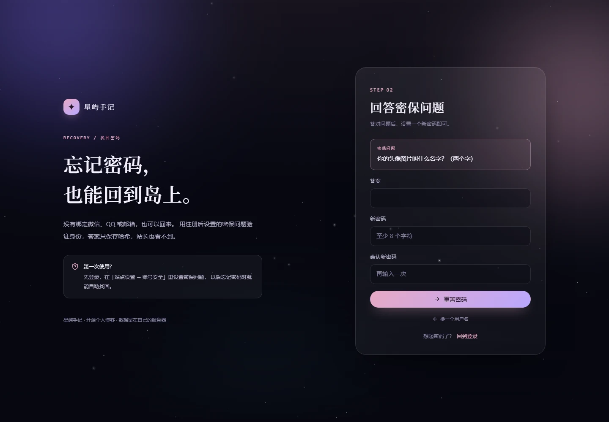
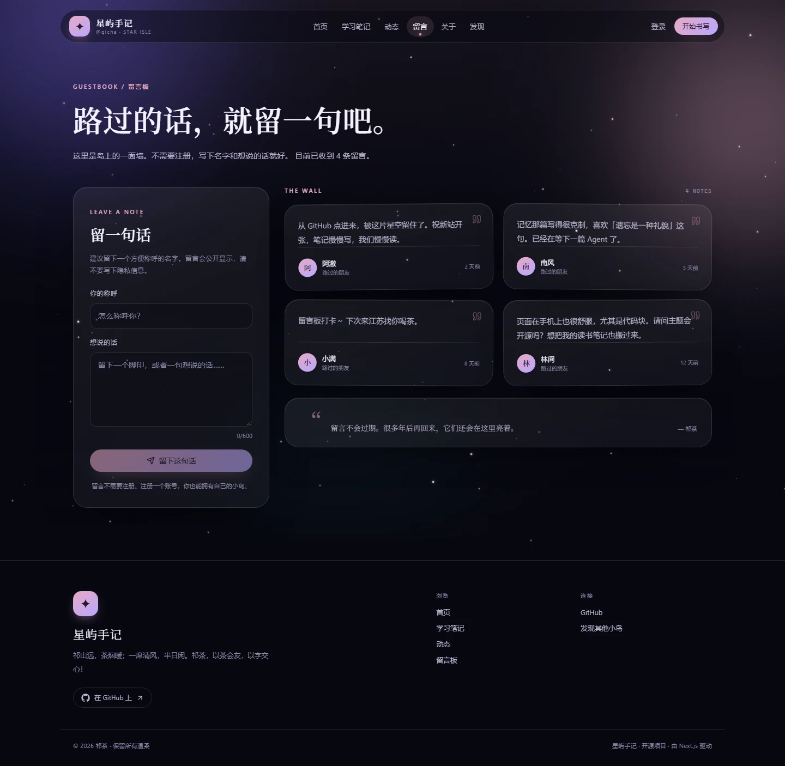
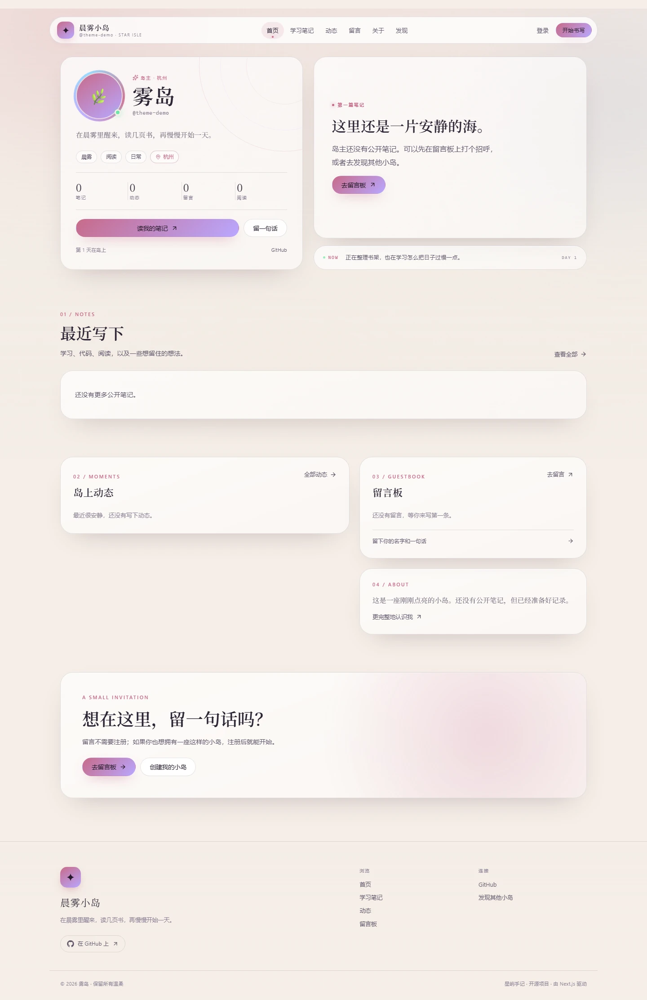
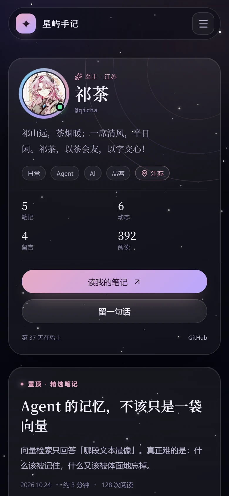

# 星屿手记 · Xingyu Blog

> 一座可以自己点亮的小岛。  
> 写下学习笔记，收藏生活碎片，留一面墙给路过的朋友。

星屿手记是一个 **多用户、可自托管** 的毛玻璃个人博客。主站是祁茶的小岛；任何人注册后，都会拥有一个 ` /u/你的名字 ` 的独立站点，以及自己的笔记、动态、留言板和主题。



## 它有什么

- **学习笔记**：Markdown 写作、实时预览、自动目录、代码高亮、阅读进度、上一篇 / 下一篇、分类与标签、草稿与置顶。
- **代码文件**：编辑器可上传 `.py`、`.ts`、`.js`、`.go`、`.sql` 等代码文件，自动识别语言并生成高亮代码块；也支持直接粘贴或拖入。
- **全文搜索**：按标题、摘要、正文与标签搜索公开笔记。
- **点赞互动**：给喜欢的笔记点赞，访客无需注册（基于访客 Cookie 去重）。
- **图片上传**：笔记内插图、编辑器粘贴上传、头像上传，支持 JPG / PNG / WebP / GIF（5MB）。
- **动态星空**：Canvas 星点漂移、闪烁、漂浮光尘与偶尔划过的流星，叠加深空极光光带。
- **动态**：短句、心情与生活碎片，按时间线展示。
- **留言板**：访客无需注册即可留言；站长与登录作者可以删除自己的留言。
- **多用户独立空间**：注册后自动获得 `/u/handle`，数据彼此隔离。
- **主题个性化**：7 套底色、强调色、玻璃通透度、圆角、衬线 / 无衬线、星空开关，全部可视化调整。
- **文字个性化**：站点名、昵称、一句简介、关于我、此刻在做什么、兴趣标签、社交链接、头像。
- **创作台**：概览、笔记管理、动态管理、留言管理、站点设置、账号安全（修改密码 / 密保问题）。
- **找回密码**：没有邮箱和第三方账号，也能用「用户名 + 密保问题」自助重置。
- **移动端适配**：从 390px 到桌面宽度都可用。
- **本地数据**：SQLite 存储在 `data/xingyu.db`，上传图片在 `data/uploads/`，备份整个 `data` 目录即可。

| 学习笔记 | 创作台 |
| --- | --- |
| [](docs/article.webp) | [](docs/studio.webp) |

| 全文搜索 | 找回密码 |
| --- | --- |
| [](docs/search.webp) | [](docs/recovery.webp) |

| 留言板 | 晨雾主题 |
| --- | --- |
| [](docs/guestbook.webp) | [](docs/theme.webp) |

<p align="center">
  
</p>

## 技术栈

Next.js 16（App Router）· React 19 · TypeScript · SQLite（Node 内置 `node:sqlite`）· Markdown（marked + highlight.js + sanitize-html）· 原生 CSS

## 快速开始

要求 **Node.js 24+**（项目使用 Node 内置 SQLite）。

```bash
git clone <your-repo-url> xingyu-blog
cd xingyu-blog
npm install
npm run dev
```

打开 http://localhost:3000 。

首次启动会自动创建 `data/xingyu.db`，并写入主站「星屿手记」的示例内容。主站内容来自 `content/seed/*.md`，只在数据库为空时导入一次。

### 演示账号

| 用户名 | 密码 |
| --- | --- |
| `qicha` 或 `祁茶` | `xingyu2026` |

登录名支持用户名或昵称。登录后请立刻到 **创作台 → 站点设置 → 账号安全** 修改密码。公开部署前请务必替换演示密码。

> 上表是首次初始化时的演示密码。如果你接手的是一个已经运行过的实例，请以站主修改后的密码为准；忘记密码可在 `/forgot` 用密保问题自助找回。

### 常用命令

```bash
npm run dev        # 开发模式（HMR）
npm run build      # 生产构建
npm start          # 启动生产服务
npm run typecheck  # TypeScript 类型检查（构建时默认跳过）
```

## 多用户是怎么工作的

- `/`：主站，默认读取 `OWNER_HANDLE` 指定的账号（默认 `qicha`）。
- `/u/:handle`：任意注册用户的独立小岛。
- `/studio`：登录后的创作台，只能管理自己的内容。
- 注册只需昵称、用户名与密码，不需要邮箱验证。

每个用户的内容、主题、留言板都是隔离的。访客可以给任何人的小岛留言；站主可以删除自己岛上的留言。

## 个性化你的小岛

登录后进入 **创作台 → 站点设置**：

1. **个人资料**：站点名、昵称、简介、所在地、标签、头像（可上传图片）、社交链接。
2. **主题外观**：星夜 / 樱雾 / 雾霾蓝 / 极光 / 暮色 / 晨雾 / 默片七套底色，再叠加强调色、玻璃强度、圆角、字体与星空。
3. **账号安全**：修改密码、设置密保问题；忘记密码时在 `/forgot` 自助找回。

主题与文字保存后会立即应用到公开站点。

## 目录结构

```text
app/
  page.tsx                 # 主站首页
  notes/ moments/ guestbook/ about/
  forgot/                  # 用户名 + 密保问题找回密码
  u/[handle]/              # 多用户公开站点
  studio/                  # 创作台（需要登录）
  api/                     # 认证、笔记、动态、留言、设置、上传、点赞、预览
components/
  site/                    # 公共站点、动态星空、点赞
  studio/                  # 创作台、编辑器、设置
  auth/                    # 登录 / 注册 / 找回密码
lib/
  db.ts                    # SQLite 数据层与种子
  auth.ts                  # 会话与当前用户
  markdown.ts              # Markdown 渲染与清洗
  theme.ts                 # 主题预设
content/seed/              # 首次启动导入的示例笔记
public/avatar.jpg          # 主站头像
data/xingyu.db             # 运行时数据库（已 gitignore）
data/uploads/              # 上传图片（已 gitignore）
```

## 环境变量

复制 `.env.example` 为 `.env.local`：

```env
SITE_URL=http://localhost:3000
OWNER_HANDLE=qicha
DATA_DIR=./data
COOKIE_SECURE=false
```

- `SITE_URL`：对外访问地址，用于 metadata / Open Graph。
- `OWNER_HANDLE`：主站使用哪个用户名作为旗舰站点。
- `DATA_DIR`：SQLite 数据目录与上传图片目录，Docker 部署时通常挂载到 `/app/data`。
- `COOKIE_SECURE`：HTTPS 部署时设为 `true`。

## 部署

推荐使用 **Docker Compose + Caddy** 部署，Caddy 会自动申请 HTTPS 证书。完整步骤见 [DEPLOY.md](DEPLOY.md)。

### 方式一：自有服务器

```bash
npm ci
npm run build
npm start
```

使用 Nginx / Caddy 反向代理到 `3000` 端口，配置 HTTPS 后设置 `COOKIE_SECURE=true` 与 `SITE_URL=https://your-domain.com`。

### 方式二：Docker

```bash
docker build -t xingyu-blog .
docker run -d --name xingyu-blog \
  -p 3000:3000 \
  -v "$(pwd)/data:/app/data" \
  -e SITE_URL=https://your-domain.com \
  -e COOKIE_SECURE=true \
  xingyu-blog
```

**数据一定要挂载 `data` 目录**，否则容器重建会丢失笔记。

> Vercel 等无状态平台不适合直接使用文件 SQLite。若要多实例部署，需要把 `lib/db.ts` 换成 PostgreSQL / MySQL 等外部数据库。

### 局域网访问

开发或自托管时，服务监听 `0.0.0.0`。同一局域网的朋友可以通过 `http://你的局域网IP:3000` 访问；跨网络访问需要公网部署或内网穿透。

## 数据与备份

- 数据库：`data/xingyu.db`（WAL 模式下还会有 `-wal` / `-shm` 文件）。
- 上传图片：`data/uploads/`。
- 备份：停止服务后复制整个 `data` 目录，或使用 SQLite 在线备份。
- 重置示例数据：停止服务，删除 `data/xingyu.db*` 与 `data/uploads/`，重新启动即可重新导入 `content/seed`。

## 安全说明

- 密码使用 `scrypt` 加盐哈希存储；会话使用随机 Token + HttpOnly Cookie。
- 密保答案只保存 `scrypt` 哈希；找回接口带简单的进程内限流，重置成功后会注销该账号的全部旧会话。
- Markdown 会在服务端经过 `sanitize-html` 清洗后再输出，避免脚本注入。
- 图片上传仅允许 JPG / PNG / WebP / GIF，单张 5MB，使用随机文件名保存，并通过 `/api/uploads/:name` 读取。
- 所有写操作都会校验当前用户是否为资源所有者。
- 当前版本的限制：没有邮箱 / OAuth 找回、没有留言限流、上传图片不会自动压缩。公开部署前建议在反向代理层增加限流，并定期备份数据库与上传目录。

## 路线图

- [ ] 图片压缩、图床与相册
- [ ] 更细的互动（收藏、评论、关注）
- [ ] 友链与相册
- [ ] RSS / 站点地图
- [ ] 自定义域名
- [ ] 邮件通知与 OAuth 登录

## 日常更新

### 只更新内容（最常用）

登录站点的 `/studio`：

- **学习笔记**：新建 / 编辑 / 删除，支持 Markdown、代码文件上传、草稿、标签与置顶。
- **动态**：发布短句。
- **留言**：管理访客留言。
- **站点设置**：修改资料、头像、主题、密码与密保问题。

保存后立即生效，不需要改代码、重新构建或 push。内容保存在 `data/`，不在 Git 仓库里。

### 更新代码或样式

本地改完后，需要重新构建并重启服务：

```bash
npm run build
npm start
```

如果当前是 `node server.mjs` 启动的，就重启它。构建前如果遇到 `.next` 文件占用，先停止服务再删除 `.next`。

### 同步到 GitHub

```bash
git add -A
git commit -m "更新说明"
git push
```

GitHub 只是代码仓库，`push` 不会自动改变正在运行的网站；要让线上生效，还需要重新构建或重新部署。

### 备份

把整个 `data/` 目录复制一份即可，里面有数据库和上传图片。更新代码不会覆盖它。

## 关于作者

本项目由 **祁茶** 设计与维护，代码、文案与视觉素材均收录在本仓库中。头像图片由作者本人提供，仅用于本站展示。

## 上传到 GitHub

```bash
git remote add origin https://github.com/fenghuangchen/xingyu-blog.git
git push -u origin main
```

如果你使用 GitHub CLI，也可以：

```bash
gh repo create xingyu-blog --public --source=. --remote=origin --push
```

仓库名和地址按你的 GitHub 账号调整即可；提交记录中的作者已经是「祁茶」。

## License

[MIT](LICENSE) © 2026 祁茶
